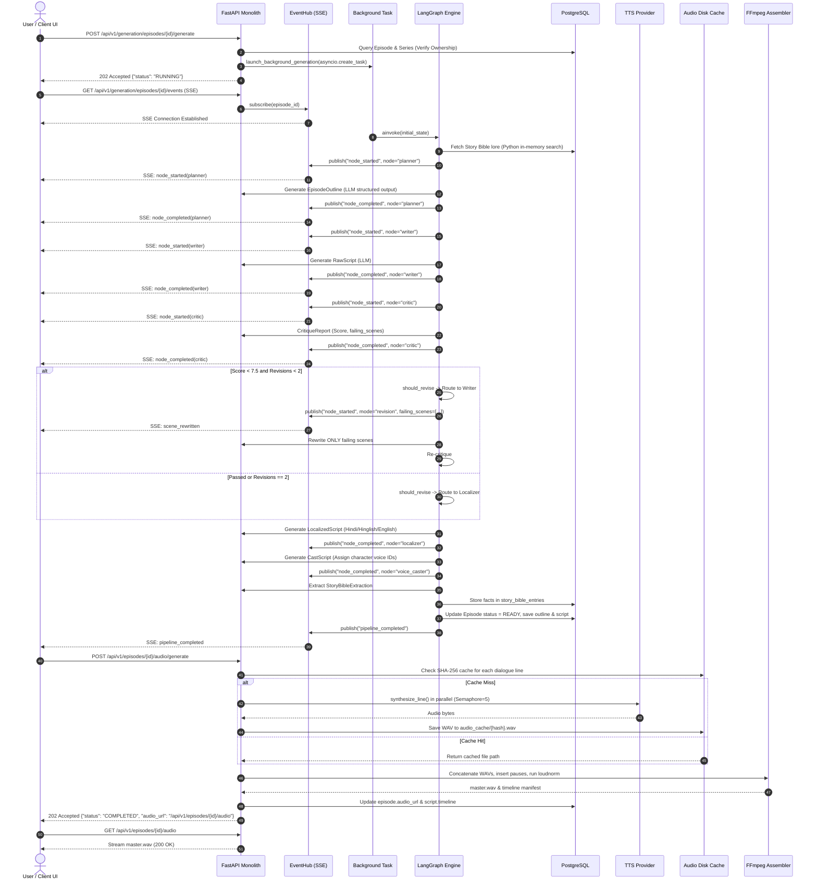
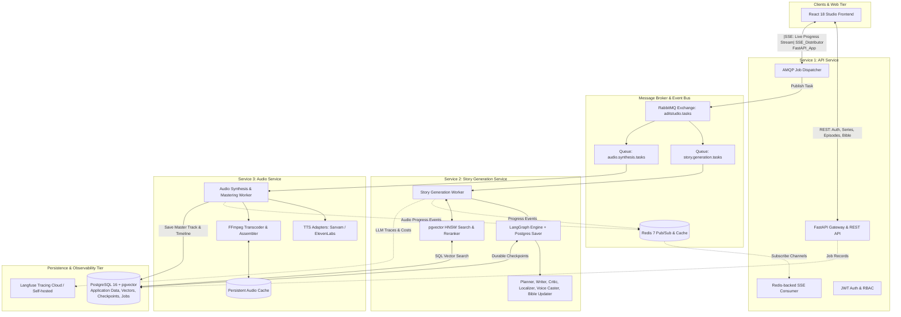
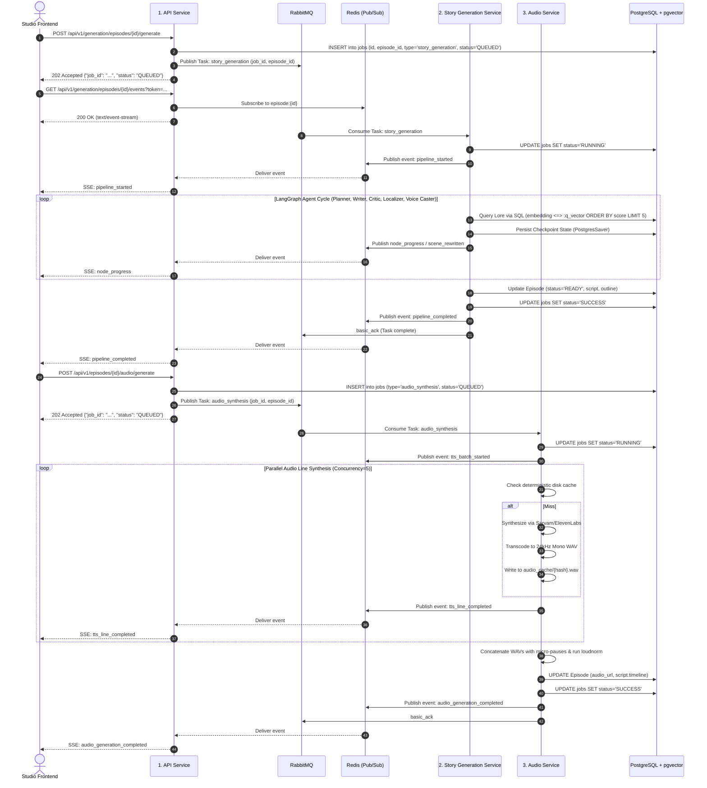
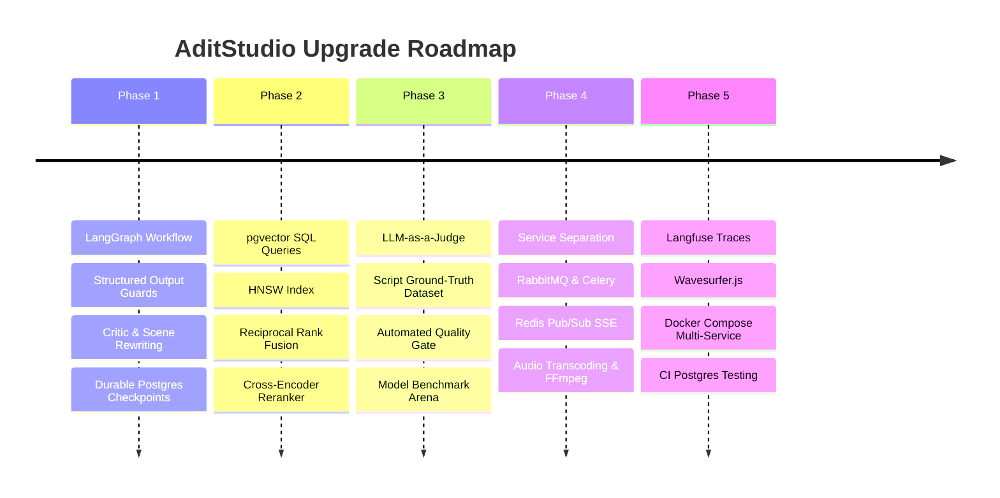

# Comprehensive Codebase Audit and Architecture Upgrade Plan: AditStudio

**Project:** Katha Studio &rarr; **AditStudio — Agentic Multilingual Story Pipeline**  
**Audit Date:** November 22, 2026  
**Auditor:** Antigravity AI Engineering Team  
**Status:** Audit Complete & Upgrade Plan Ready (Planning Only — No application source code modified)

---

## 1. Existing Project Architecture

Katha Studio is an agentic platform designed to generate serialized, multi-character audio stories in Hindi, Hinglish, and English. The existing system operates as a monolithic application with a FastAPI backend and a React/Vite single-page application (SPA).

```mermaid
flowchart TD
    subgraph Client [Frontend - React 18 / Vite / Tailwind]
        UI[React Studio UI]
        SSE_Client[EventSource SSE Listener]
        Audio_Tag[HTML5 Audio Player]
    end

    subgraph Monolith [FastAPI Monolithic Backend]
        Router[API Endpoints: Auth, Series, Episodes, Audio, Eval]
        EventHub[EventHub: Memory Queues + One-way Redis Publish]
        InProcessRunner[asyncio.create_task in-memory runner]
        Checkpointer[MemorySaver in-memory checkpointer]
        
        subgraph Agents [LangGraph 0.2 Cyclical Pipeline]
            P[Planner] --> W[Writer]
            W --> C[Critic]
            C --> R{should_revise<br/>Max 2 cycles}
            R -- Failing Scenes --> W
            R -- Pass / Cap Reached --> L[Localizer]
            L --> VC[Voice Caster]
            VC --> BU[Bible Updater]
        end

        subgraph Services [Internal Python Services]
            SBService[StoryBibleService: In-Memory Cosine & RRF]
            AudioOrch[AudioOrchestrationService: asyncio.gather]
            AudioAssembler[FFmpegAudioAssembler: wave module + CLI loudnorm]
            AudioCache[AudioCacheService: SHA-256 disk cache]
            EvalService[LLMJudgeEvaluator: 5D rubric]
        end
    end

    subgraph Data [Storage & External]
        PG[(PostgreSQL 16 + pgvector)]
        Redis[(Redis 7)]
        Disk[(Local Disk: audio_cache/)]
        LLM_Ext[LLM APIs: Gemini / Groq / Mock]
        TTS_Ext[TTS APIs: ElevenLabs / Sarvam / Mock]
    end

    UI --> Router
    SSE_Client --> Router
    Router --> InProcessRunner
    InProcessRunner --> Agents
    Agents <--> SBService
    Agents <--> Checkpointer
    Agents -. Publish events .-> EventHub
    EventHub -. publish .-> Redis
    EventHub -. queue.put .-> SSE_Client

    Router --> AudioOrch
    AudioOrch --> AudioCache
    AudioOrch --> TTS_Ext
    AudioOrch --> AudioAssembler
    AudioAssembler --> Disk

    Router --> PG
    SBService --> PG
```

### Key Architectural Characteristics
1. **Monolithic Process Execution:** API serving, agent workflow orchestration, and CPU/IO audio synthesis run in the same single Python OS process.
2. **In-Memory Background Jobs:** Workflows are launched using `asyncio.create_task()` stored in an in-memory dictionary (`_running_jobs`).
3. **In-Memory Checkpointing:** LangGraph relies on `MemorySaver()`; PostgreSQL durable checkpointing is not active in production runtime.
4. **Hybrid Persistence Mode:** Models are built with SQLAlchemy 2.0 (asyncpg), with a fallback `SafeVector` type decorator enabling execution on both SQLite and PostgreSQL.
5. **Decoupled Client Streaming:** Live pipeline node transitions are streamed via Server-Sent Events (SSE).

---

## 2. Existing Directory and Component Structure

```
/Users/adityatiwary/Desktop/Test_folder/
├── AGENTS.md                          # Engineering guidelines, zero-silent-failure rules, audio rules
├── PROJECT_CONTEXT.md                 # Product vision, high-level architecture, roadmap
├── README.md                          # Setup, features, run instructions
├── Makefile                           # Developer CLI targets (test, lint, eval-gate, calibrate)
├── docker-compose.yml                 # Local dev stack: PostgreSQL 16 (pgvector), Redis 7, Backend, Frontend
├── docker-compose.prod.yml            # Production compose stack
├── docs/                              # Architecture, API specs, eval report, decisions, deployment, limitations
│   ├── api-reference.md
│   ├── architecture.md
│   ├── deployment.md
│   ├── engineering-decisions.md
│   ├── eval-report.md
│   └── limitations.md
├── audio_cache/                       # Persistent audio segment & master WAV disk cache
│   └── episodes/
├── backend/
│   ├── Dockerfile                     # Multi-stage Python 3.11 container with FFmpeg
│   ├── alembic.ini                    # Alembic migration configuration
│   ├── pyproject.toml                 # Backend dependencies, ruff, mypy, pytest configs
│   ├── requirements.txt               # Pinned pip requirements
│   ├── entrypoint.sh                  # Database migration & uvicorn startup
│   ├── alembic/
│   │   ├── env.py                     # Async Alembic execution environment
│   │   └── versions/                  # 001_initial_schema, 002_story_bible, 003_evaluations
│   ├── app/
│   │   ├── main.py                    # FastAPI entrypoint, lifespan, RFC 7807 error handlers
│   │   ├── api/
│   │   │   ├── deps.py                # Auth, DB, and provider dependencies
│   │   │   └── v1/
│   │   │       ├── router.py          # Unified API router
│   │   │       ├── auth.py            # JWT register, login, refresh, me
│   │   │       ├── series.py          # Series CRUD & Story Bible inspection
│   │   │       ├── episodes.py        # Episode CRUD & outline generation
│   │   │       ├── generation.py      # /generate trigger & SSE /events endpoints
│   │   │       ├── audio.py           # Audio generation, streaming, line regeneration
│   │   │       ├── story_bible.py     # Story Bible manual search & entry creation
│   │   │       └── evaluations.py     # Golden dataset, evaluation runs, calibration API
│   │   ├── agents/
│   │   │   ├── state.py               # KathaEpisodeState TypedDict definition
│   │   │   ├── graph.py               # LangGraph StateGraph assembly & conditional compilation
│   │   │   ├── router.py              # should_revise conditional routing logic (max 2 revisions)
│   │   │   ├── runner.py              # EpisodePipelineService & in-memory task dispatcher
│   │   │   ├── checkpointer.py        # AsyncPostgresSaver vs MemorySaver factory
│   │   │   ├── planner.py             # Episode outline generator with RAG context injection
│   │   │   ├── writer.py              # Scene script writer with failing-scene revision mode
│   │   │   ├── critic.py              # Dramatic rubric evaluator & failing scene identifier
│   │   │   ├── localizer.py           # Hindi/Hinglish/English dialogue localizer
│   │   │   ├── voice_caster.py        # Voice archetype mapping & TTS voice assigner
│   │   │   └── bible_updater.py       # Episodic lore extractor and Story Bible updater
│   │   ├── core/
│   │   │   ├── config.py              # Pydantic BaseSettings
│   │   │   ├── database.py            # Async engine & sessionmaker
│   │   │   ├── security.py            # JWT and bcrypt operations
│   │   │   ├── exceptions.py          # RFC 7807 hierarchy (KathaException)
│   │   │   ├── events.py              # EventHub SSE pub/sub manager
│   │   │   └── telemetry.py           # Spans, latency, and token cost estimator
│   │   ├── models/                    # SQLAlchemy async models: User, Series, Episode, StoryBibleEntry, EvaluationRun
│   │   ├── schemas/                   # Pydantic v2 domain schemas (outline, script, evaluation, error, user)
│   │   ├── providers/                 # LLM & TTS provider abstraction layer
│   │   │   ├── base.py                # BaseLLMProvider & BaseTTSProvider interfaces
│   │   │   ├── mock.py                # Deterministic MockLLMProvider & MockEmbeddingProvider
│   │   │   ├── gemini.py              # Google Gemini 1.5/2.0 provider with JSON schema mode
│   │   │   ├── groq.py                # Groq (Llama 3.3/3.1) provider
│   │   │   ├── embedding/             # MockEmbeddingProvider & BaseEmbeddingProvider
│   │   │   └── tts/                   # BaseTTSProvider, MockTTSProvider, ElevenLabsTTSProvider, SarvamTTSProvider
│   │   ├── services/
│   │   │   ├── story_bible.py         # StoryBibleService (hybrid search, cosine similarity, RRF)
│   │   │   ├── audio_cache.py         # Deterministic SHA-256 disk audio cache
│   │   │   ├── audio_assembler.py     # FFmpegAudioAssembler (wave frame concatenator & loudnorm)
│   │   │   ├── audio_orchestrator.py  # AudioOrchestrationService (bounded concurrent synthesis)
│   │   │   ├── evaluator.py           # LLMJudgeEvaluator & calibration runner
│   │   │   └── experiments.py         # Multi-model benchmarking harness
│   │   └── eval/
│   │       ├── golden_dataset.py      # Golden benchmark dataset loader (35 premises)
│   │       ├── golden_dataset.json    # 35 benchmark cases across Hindi, Hinglish, English
│   │       └── calibration_dataset.py # 30 human-labeled benchmark rating entries
│   ├── scripts/
│   │   └── eval_gate.py               # Standalone CI quality, safety, and cost gate
│   └── tests/                         # 49 unit and integration tests across all modules
└── frontend/
    ├── package.json                   # React 18, Vite, Tailwind, Lucide React
    ├── tsconfig.json                  # Strict TypeScript configuration
    ├── vite.config.ts                 # Dev server with proxy to backend :8000
    ├── nginx.conf                     # Nginx proxy with SSE buffering disabled
    ├── Dockerfile                     # Multi-stage node build + nginx container
    └── src/
        ├── App.tsx                    # React Router (Login, Register, SeriesList, SeriesDetail, EpisodeStudio, EvalDash)
        ├── context/AuthContext.tsx     # JWT auth state & persistent session management
        ├── services/api.ts            # Typed HTTP client & SSE event source URL builder
        ├── types/index.ts             # Shared TypeScript schemas matching backend Pydantic models
        └── pages/
            ├── Login.tsx / Register.tsx
            ├── SeriesList.tsx         # Series overview & deletion
            ├── CreateSeries.tsx       # Series creation form
            ├── SeriesDetail.tsx       # Episodes list, Story Bible viewer, manual entry form
            ├── EpisodeStudio.tsx      # Core studio: generation triggers, SSE progress, line editor, audio player
            └── EvaluationDashboard.tsx# Golden dataset runs, benchmark arena, calibration runner
```

---

## 3. Feature-by-Feature Implementation Status

| Component / Feature | Classification | Technical Assessment & Evidence |
|:---|:---|:---|
| **FastAPI REST API & Auth** | **Fully implemented and working** | Complete JWT authentication flow (register, login, refresh, `/auth/me`), password hashing with bcrypt, RFC 7807 Problem Details error handling. Series ownership verification enforced on all CRUD routes. |
| **LangGraph Agent Workflow** | **Implemented but needs improvement** | StateGraph with 6 nodes (`planner`, `writer`, `critic`, `localizer`, `voice_caster`, `bible_updater`) executes deterministically with typed `KathaEpisodeState`. However, in-memory `MemorySaver` is hardcoded in the runner instead of durable Postgres checkpointing. |
| **Critic & Bounded Revision Loop** | **Fully implemented and working** | `should_revise` strictly caps revision cycles at 2 (`MAX_REVISIONS = 2`, `PASSING_SCORE = 7.5`). The Writer agent in revision mode targets **only** `failing_scenes` identified by the Critic, preserving already passing scenes. Verified by `test_conditional_revision_loop_rewrites_only_failing_scenes` and `test_revision_limits_strict_cap_at_two`. |
| **Story Bible Lore Ingestion** | **Fully implemented and working** | `bible_updater` extracts structured entities (`characters`, `relationships`, `locations`, `open_plot_threads`, `synopsis`) and saves them to `story_bible_entries` with deduplication and metadata updates. |
| **Story Bible Hybrid Search & RAG** | **Implemented but needs improvement** | Search is called during planning and writing. However, vector similarity is computed in **Python memory** (`cosine_similarity()`) rather than executing SQL cosine distance (`<=>`) via pgvector. Sparse search is naive Python string token matching, and reranking uses hardcoded entity multipliers (1.2x/1.25x) instead of a cross-encoder model. |
| **Audio Hash Caching** | **Fully implemented and working** | `AudioCacheService` keys files by `SHA256(text + voice_id + speed + pitch + emotion + provider_id + model_version)`. Hits skip TTS calls completely. Validated by unit tests. |
| **Parallel Audio Synthesis** | **Implemented but needs improvement** | `AudioOrchestrationService` uses `asyncio.gather` bounded by `asyncio.Semaphore(5)`. Works with Mock and Sarvam WAV output, but crashes when providers return MP3 containers (e.g. ElevenLabs) because downstream assembler expects RIFF WAV headers. |
| **FFmpeg Stitching & Mastering** | **Implemented but needs improvement** | Generates silence buffers (250ms inter-dialogue, 800ms scene transitions) and builds timeline manifests. Calls FFmpeg `loudnorm=I=-16:TP=-1.5:LRA=11` via `subprocess.run()`. However, frame concatenation uses Python's `wave` module directly, making it fragile against mixed sample rates and non-WAV inputs. |
| **Interactive Line Regeneration** | **Fully implemented and working** | `/episodes/{id}/lines/{line_id}/regenerate` modifies target line text/voice/emotion, synthesizes only the changed segment, loads unchanged segments from disk cache, and re-stitches the master timeline without full episode re-runs. |
| **SSE Real-time Streaming** | **Implemented but needs improvement** | SSE streaming works end-to-end within a single worker process. However, `EventHub.subscribe()` reads strictly from an in-process `asyncio.Queue`. While `EventHub.publish()` publishes to Redis, `subscribe()` never listens to Redis Pub/Sub, breaking SSE whenever publisher and subscriber run in separate processes. |
| **Background Jobs & Checkpointing** | **Partially implemented** | Generation runs via `asyncio.create_task()` in the web server process. In-flight jobs are tracked in a volatile global dict (`_running_jobs`), meaning server restarts immediately terminate active pipelines without resumption. Checkpointing in production falls back to `MemorySaver()`. |
| **Golden Benchmark Dataset** | **Fully implemented and working** | 35 multi-genre, multilingual benchmark cases in `golden_dataset.json` with difficulty ratings and evaluation parameters. Automated CI quality gate (`eval_gate.py`) verifies pass rate (&ge;85%), composite score (&ge;3.5), and cost limits. |
| **Evaluation Calibration** | **Partially implemented** | Mathematical routines (`compute_spearman_rho`, `compute_weighted_cohens_kappa`, `compute_mae`) are fully implemented. However, `HUMAN_CALIBRATION_BENCHMARK` contains only score dictionaries and notes without script bodies; the evaluator evaluates metadata strings rather than scripts, yielding poor correlation (`NEEDS_TUNING`, Spearman $\rho \approx 0.27$). |
| **Telemetry & Observability** | **Partially implemented** | Custom `TelemetryTracer` records spans, latency, token consumption, and dollar costs. However, Langfuse integration is purely mock/in-memory: no traces are dispatched to any external Langfuse instance. |
| **Langfuse Integration** | **Present only in documentation / config** | Configuration fields (`LANGFUSE_PUBLIC_KEY`, `LANGFUSE_SECRET_KEY`) exist in `config.py`, but the `langfuse` SDK is not installed, no client is instantiated, and no traces are sent. |
| **Wavesurfer.js Audio Player** | **Present only in documentation** | Documented in `README.md` and `PROJECT_CONTEXT.md`, but `wavesurfer.js` is absent from `frontend/package.json`. The frontend uses standard HTML5 `<audio>` with a custom CSS scrubber. |
| **PostgreSQL + pgvector in CI** | **Present only in configuration** | Docker Compose runs `pgvector/pgvector:pg16`, and Alembic migration `002_story_bible.py` enables the vector extension. However, GitHub Actions CI runs with `DATABASE_URL: sqlite+aiosqlite:///:memory:`, so pgvector is never validated in CI. |

---

## 4. Existing Technology Stack

### Backend Stack
- **Language & Runtime:** Python 3.11 / Python 3.14 (macOS local dev)
- **Web Framework:** FastAPI 0.115.0 with Uvicorn 0.30.0
- **Validation & Settings:** Pydantic v2.8.0, Pydantic-Settings 2.4.0
- **Database ORM & Migrations:** SQLAlchemy 2.0.32 (Asyncio), Alembic 1.13.0
- **Database Drivers:** `asyncpg` 0.29.0 (PostgreSQL), `aiosqlite` 0.20.0 (SQLite local/test fallback)
- **Agent Orchestration:** LangGraph 0.2.0, LangChain Core 0.3.0
- **Cache & Pub/Sub Client:** `redis` 5.0.0
- **Security:** `pyjwt[crypto]` 2.9.0, `bcrypt` 4.0.1
- **HTTP Client:** `httpx` 0.27.0
- **Audio Processing:** Python standard library `wave`, system `ffmpeg` binary via `subprocess`
- **Testing:** `pytest` 9.2.0, `pytest-asyncio` 1.4.1, `pytest-cov` 5.0.0

### Frontend Stack
- **Framework & Tooling:** React 18.3.1, Vite 5.4.11, TypeScript 5.6.3
- **Styling:** Tailwind CSS 3.4.15, PostCSS, Autoprefixer
- **UI Icons:** `lucide-react` 0.460.0
- **Routing:** `react-router-dom` 6.28.0
- **Server Reverse Proxy:** Nginx 1.25 Alpine

### Infrastructure & DevOps
- **Containerization:** Docker multi-stage builds (`python:3.11-slim` with FFmpeg, `node:20-alpine`, `nginx:alpine`)
- **Orchestration:** Docker Compose (services: `db` [pgvector pg16], `redis` [redis 7-alpine], `backend`, `frontend`)
- **CI Pipelines:** GitHub Actions (`ci.yml`, `eval_gate.yml`)

---

## 5. Current Execution Flow: User Request to Final Audio



---

## 6. Existing Background Processing and Event Communication

### Background Processing (`backend/app/agents/runner.py`)
```python
_running_jobs: dict[str, asyncio.Task[Any]] = {}

def launch_background_generation(episode_id: str, llm: BaseLLMProvider) -> bool:
    if episode_id in _running_jobs and not _running_jobs[episode_id].done():
        return False
    async def _runner() -> None:
        try:
            await pipeline_service.run_pipeline(episode_id, llm)
        finally:
            _running_jobs.pop(episode_id, None)
    task = asyncio.create_task(_runner())
    _running_jobs[episode_id] = task
    return True
```

#### Vulnerabilities:
1. **Volatile In-Memory Lifecycle:** If Uvicorn restarts, crashes, or is deployed behind multiple worker processes (`uvicorn --workers 4`), the task is aborted mid-generation without recovery.
2. **Missing Distributed Lock:** When running multiple instances, requests can execute duplicate pipelines concurrently.
3. **No Retries / Exponential Backoff:** If an external LLM rate-limit or network timeout fails the task, the status transitions to `FAILED` immediately with no retry scheduling.

### Event Communication (`backend/app/core/events.py`)
```python
class EventHub:
    def __init__(self) -> None:
        self.subscribers: dict[str, list[asyncio.Queue[str]]] = {}
        self._redis: Redis | None = None
        self._redis_available: bool = False
...
    async def publish(self, episode_id: str, event_type: str, payload: dict, node: str = None):
        # 1. Delivers to in-memory queue
        if episode_id in self.subscribers:
            for q in self.subscribers[episode_id]:
                await q.put(serialized)
        # 2. Publishes to Redis channel
        if self._redis_available and self._redis:
            await self._redis.publish(f"episode:{episode_id}", serialized)

    async def subscribe(self, episode_id: str) -> AsyncGenerator[str, None]:
        queue: asyncio.Queue[str] = asyncio.Queue()
        self.subscribers[episode_id].append(queue)
        while True:
            msg = await queue.get()
            yield f"data: {msg}\n\n"
```

#### Flaw Identified:
`EventHub.publish()` sends messages to Redis Pub/Sub, but **`EventHub.subscribe()` never listens to Redis**. It only yields from `self.subscribers[episode_id]`, which is populated exclusively by events published within the same Python process. If tasks run in separate worker processes, clients connected to the API server will never receive the events.

---

## 7. Major Bugs, Architectural Weaknesses, and Missing Features

### 1. In-Memory RAG Bottleneck in `StoryBibleService`
- **Location:** `backend/app/services/story_bible.py#L227-L255`
- **Issue:** Instead of querying PostgreSQL vector distances via SQL (`SELECT * FROM story_bible_entries ORDER BY embedding <=> query_vector LIMIT 5`), the service executes `SELECT * FROM story_bible_entries WHERE series_id = :series_id`, loads all records into the Python heap, and computes cosine similarity in a Python loop.
- **Impact:** O($N$) memory consumption and high CPU latency as series lore expands. Reranking is simulated via a hardcoded float multiplier (`1.2` for character entries, `1.25` for plot threads) rather than a proper cross-encoder reranker.

### 2. Audio Container Parsing Failure with ElevenLabs MP3
- **Location:** `backend/app/services/audio_assembler.py#L82`, `backend/app/providers/tts/elevenlabs.py#L73`
- **Issue:** `ElevenLabsTTSProvider` requests `Accept: audio/mpeg` and returns MP3 bytes. `AudioCacheService` saves this payload with a `.wav` extension. When `FFmpegAudioAssembler` tries to open it with `wave.open(str(audio_path), "rb")`, Python throws:
  `wave.Error: file does not start with RIFF id`.
- **Impact:** Using ElevenLabs crashes the audio pipeline during assembly.

### 3. Checkpoint Context Closure & MemorySaver Default
- **Location:** `backend/app/agents/checkpointer.py#L28-L30`, `backend/app/agents/runner.py#L25`
- **Issue:** `EpisodePipelineService` initializes with `self.checkpointer = checkpointer or get_in_memory_checkpointer()`. Furthermore, in `get_checkpointer()`, `AsyncPostgresSaver.from_conn_string()` is entered in an `async with` block that exits immediately before returning the saver object, closing the connection.
- **Impact:** Workflows do not persist durable checkpoints to PostgreSQL in production.

### 4. SSE Multi-Process Disconnect
- **Location:** `backend/app/core/events.py#L61-L82`
- **Issue:** `EventHub.subscribe()` does not consume Redis Pub/Sub.
- **Impact:** Splitting the API into background workers or scaling Uvicorn beyond a single worker breaks live progress updates on the frontend.

### 5. Synthetic Calibration Dataset Lacking Dialogue Text
- **Location:** `backend/app/eval/calibration_dataset.py#L7-L253`, `backend/app/services/evaluator.py#L183-L187`
- **Issue:** `HUMAN_CALIBRATION_BENCHMARK` provides human scores and notes, but **no script text**. In `evaluator.py`, the evaluation is invoked as:
  `script=f"Title: {sample.title}\nLanguage: {sample.target_language}\nNotes: {sample.human_notes}"`
- **Impact:** The LLM judge grades a 3-line metadata snippet rather than a drama script, causing low correlation ($\rho \approx 0.27$, `NEEDS_TUNING`).

### 6. Missing Wavesurfer.js in Frontend
- **Location:** `frontend/package.json`, `frontend/src/pages/EpisodeStudio.tsx#L242`
- **Issue:** `package.json` contains no Wavesurfer dependency despite claims in documentation. The UI uses an HTML5 `<audio>` tag.
- **Impact:** No true waveform rendering, audio scrubbing visualization, or line-marker overlays.

### 7. Phantom Langfuse Integration
- **Location:** `backend/app/core/telemetry.py#L74-L97`
- **Issue:** `TelemetryTracer` records spans in a private Python list `self._spans`. The `langfuse` Python SDK is not imported or installed.
- **Impact:** No traces, generation parameters, or cost analytics are dispatched to Langfuse.

### 8. SQLite Bypasses pgvector in CI
- **Location:** `.github/workflows/ci.yml#L46`, `.github/workflows/eval_gate.yml#L17`
- **Issue:** CI uses `DATABASE_URL: sqlite+aiosqlite:///:memory:`. While `SafeVector` prevents crashes by mapping embeddings to JSON in SQLite, the pgvector extension and SQL vector operations are never executed or validated in automated CI.

---

## 8. Testing Status and Actual Test Execution Results

All commands were executed directly against the local repository environment:

### 1. Pytest Backend Suite (`.venv/bin/pytest backend/tests -v`)
- **Collected:** 49 items across 10 test modules
- **Passed:** **49 passed**, 13 deprecation warnings (Python 3.14 async warnings) in **8.38 seconds**
- **Results by Module:**
  - `test_agents_pipeline.py`: 6 passed (full graph execution, revision loop, scene targeting, max revision cap)
  - `test_audio.py`: 5 passed (audio synthesis validation, hash caching, error handling, pause stitching)
  - `test_auth.py`: 7 passed (registration, duplicate checks, login, JWT validation, `/me` profile)
  - `test_checkpointer.py`: 2 passed (in-memory state persistence and resumption)
  - `test_episodes.py`: 3 passed (episode creation, permissions, outline generation)
  - `test_evaluation.py`: 9 passed (rubric evaluation, golden dataset loading, math metrics)
  - `test_migrations.py`: 1 passed (Alembic migration execution)
  - `test_providers.py`: 5 passed (Gemini/Groq mock responses and error paths)
  - `test_series.py`: 3 passed (series CRUD and cascading relationships)
  - `test_story_bible.py`: 8 passed (entity storage, deduplication, search status tracking)

### 2. Frontend Production Build (`cd frontend && npm run build`)
- **TypeScript Typecheck (`tsc`):** Passed with **0 errors**.
- **Vite Production Bundler:** Built in **1.33 seconds**.
  - `dist/index.html`: 0.91 kB
  - `dist/assets/index-Dv1eWaaj.css`: 29.13 kB
  - `dist/assets/index-Bmm0qtEH.js`: 270.66 kB

### 3. CI Evaluation Quality Gate (`eval_gate.py --samples 5`)
- **Command:** `PYTHONPATH=backend .venv/bin/python backend/scripts/eval_gate.py --samples 5`
- **Exit Code:** `0` (Success)
- **Results:**
  - Pass Rate: **100.0%** (Required &ge; 85.0%)
  - Avg Composite Score: **4.77 / 5.0** (Required &ge; 3.50)
  - Avg Cost / Episode: **$0.00015** (Required &le; $0.0500)
  - Safety Violations: **0**

### 4. Evaluator Judge Calibration Check
- **Command:** `PYTHONPATH=backend .venv/bin/python -c "import asyncio; from app.services.evaluator import evaluator_service; r = asyncio.run(evaluator_service.run_calibration()); print('Status:', r.calibration_status); print('Spearman Rho:', r.spearman_correlation); print('Weighted Kappa:', r.weighted_cohens_kappa); print('MAE:', r.mean_absolute_error)"`
- **Results:**
  - `Status: NEEDS_TUNING`
  - `Spearman Rho (Composite): 0.2688` (Threshold for acceptable is &ge; 0.55)
  - `Weighted Kappa (Composite): 0.2781`
  - `MAE (Composite): 0.8457`
- **Finding:** Statistical routines function, but the underlying calibration dataset lacks actual script texts, proving that calibration currently tests metadata rather than dramatic quality.

---

## 9. Proposed Target Architecture

To evolve AditStudio into a moderately advanced AI engineering system without unnecessary distributed systems complexity, the monolith will be split into **three independently runnable application services** backed by **RabbitMQ**, **Redis**, and **PostgreSQL + pgvector**.



### Justification for Architecture & Technology Choices
1. **Three Runnable Services:**
   - **API Service:** Light, fast, stateless HTTP gateway handling auth, validation, database CRUD, job dispatching, and SSE connections.
   - **Story Generation Service:** Long-running, agentic LangGraph workflow worker handling LLM interactions, RAG retrieval, and durable Postgres checkpoints.
   - **Audio Service:** CPU- and network-IO-intensive audio worker executing concurrent TTS requests, MP3/WAV transcoding, and FFmpeg audio mastering.
2. **RabbitMQ for Task Distribution:**
   - Solves the critical in-memory failure mode.
   - Guarantees message delivery via explicit ACKs (`basic_ack`), dead-letter exchanges (`DLX`) for unhandled failures, and fair dispatch (`prefetch_count=1`).
   - Jobs survive API restarts and can be inspected via RabbitMQ management UI.
   - **Worker Implementation:** Uses Celery with RabbitMQ broker. Celery is mature, provides robust task state tracking, automatic worker concurrency management, and straightforward task routing, avoiding custom AMQP loop boilerplate.
3. **Redis for SSE Event Distribution:**
   - Solves the multi-process SSE disconnect bug. Workers publish lifecycle events (`node_started`, `scene_rewritten`, `tts_progress`) to Redis channels (`episode:{id}`).
   - The API service's SSE endpoint subscribes to the channel via `redis.pubsub()` and streams messages to the client.
4. **PostgreSQL 16 + pgvector as Primary Unified Data Store:**
   - Single source of truth for users, series, episodes, jobs, story bible embeddings, and LangGraph checkpoints (`AsyncPostgresSaver`).
   - No need to maintain a separate vector database (e.g. Pinecone/Qdrant) or document store.

---

## 10. Proposed Service Communication Flow



---

## 11. Required Dependencies and Infrastructure Changes

### 1. Infrastructure (`docker-compose.yml`)
- **Add RabbitMQ Container:**
  ```yaml
  rabbitmq:
    image: rabbitmq:3-management-alpine
    container_name: aditstudio_rabbitmq
    ports:
      - "5672:5672"    # AMQP protocol
      - "15672:15672"  # Management dashboard
    environment:
      RABBITMQ_DEFAULT_USER: adit
      RABBITMQ_DEFAULT_PASS: adit_secret
    healthcheck:
      test: ["CMD", "rabbitmq-diagnostics", "check_port_connectivity"]
      interval: 5s
      timeout: 5s
      retries: 5
  ```
- **Split Backend Service into 3 Service Containers:**
  - `api`: runs `uvicorn app.main:app --host 0.0.0.0 --port 8000`
  - `story-worker`: runs `celery -A app.workers.celery_app worker -Q story_queue -c 2`
  - `audio-worker`: runs `celery -A app.workers.celery_app worker -Q audio_queue -c 4`

### 2. Backend Python Dependencies (`pyproject.toml`)
- Add `celery[redis]>=5.4.0` (Job processing & AMQP client)
- Add `kombu>=5.3.7` (AMQP messaging abstractions)
- Add `langfuse>=2.50.0` (Official Langfuse Python SDK)
- Add `pydub>=0.25.1` or `soundfile>=0.12.1` (Robust cross-format audio decoding/transcoding)
- Add `pgvector>=0.3.5` (Native SQLAlchemy vector operations)
- Add `sentence-transformers>=3.0.0` or official Gemini Embedding SDK (Genuine multilingual dense embeddings)

### 3. Frontend Dependencies (`package.json`)
- Add `wavesurfer.js>=7.8.0` (Interactive waveform rendering and line seeking)

---

## 12. Database and API Changes

### 1. Database Schema Changes (`Alembic 004_target_architecture.py`)
1. **Persistent Jobs Table (`jobs`):**
   ```sql
   CREATE TABLE jobs (
       id VARCHAR(36) PRIMARY KEY,
       episode_id VARCHAR(36) REFERENCES episodes(id) ON DELETE CASCADE,
       job_type VARCHAR(50) NOT NULL, -- 'story_generation', 'audio_synthesis', 'line_regeneration'
       status VARCHAR(30) NOT NULL,   -- 'QUEUED', 'RUNNING', 'SUCCESS', 'FAILED', 'RETRYING'
       retry_count INTEGER DEFAULT 0,
       error_details JSONB DEFAULT '{}',
       result_metadata JSONB DEFAULT '{}',
       created_at TIMESTAMPTZ NOT NULL,
       updated_at TIMESTAMPTZ NOT NULL
   );
   CREATE INDEX ix_jobs_episode_id ON jobs(episode_id);
   CREATE INDEX ix_jobs_status ON jobs(status);
   ```
2. **PostgreSQL pgvector HNSW Index on Story Bible:**
   ```sql
   CREATE INDEX ix_story_bible_hnsw ON story_bible_entries 
   USING hnsw (embedding vector_cosine_ops) 
   WITH (m = 16, ef_construction = 64);
   ```
3. **Full-Text Search Index on Story Bible:**
   ```sql
   ALTER TABLE story_bible_entries ADD COLUMN tsv_content tsvector 
   GENERATED ALWAYS AS (to_tsvector('english', entity_name || ' ' || content)) STORED;
   CREATE INDEX ix_story_bible_tsv ON story_bible_entries USING gin(tsv_content);
   ```
4. **LangGraph Durable Checkpointer Tables:**
   - Execute setup migrations for `AsyncPostgresSaver` schema (`checkpoints`, `checkpoint_blobs`, `checkpoint_writes`).

### 2. API Contract Changes
1. **`POST /api/v1/generation/episodes/{id}/generate`**
   - Returns `202 Accepted` with:
     ```json
     {
       "job_id": "job_94a7e8...",
       "episode_id": "ep_123...",
       "status": "QUEUED",
       "message": "Story generation job enqueued."
     }
     ```
2. **`POST /api/v1/episodes/{id}/audio/generate`**
   - Updated to asynchronous behavior (returns `202 Accepted` with `job_id` instead of blocking for master assembly).
3. **`GET /api/v1/jobs/{job_id}`** (New endpoint)
   - Inspects persistent status, progress, latency, error traces, and retry attempts.
4. **`GET /api/v1/generation/episodes/{id}/events`**
   - Refactored to listen directly to Redis Pub/Sub channel `episode:{id}`.

---

## 13. Prioritized Implementation Roadmap

Organized into the five requested phases:



---

### Phase 1: Improve AI Agents
**Focus:** Agent reliability, structured output enforcement, bounded revision cycles, and durable checkpoint recovery.

- **Existing Files to Modify:**
  - `backend/app/agents/graph.py`: Inject durable checkpointer and compile graph.
  - `backend/app/agents/checkpointer.py`: Refactor `get_checkpointer` to manage connection pooling cleanly with `AsyncPostgresSaver`.
  - `backend/app/agents/writer.py`: Refine failing scene rewrite prompt with strict diffing and character persona anchors.
  - `backend/app/agents/critic.py`: Enforce strict JSON schema validation and structured feedback per scene.
  - `backend/app/agents/router.py`: Add cycle guard logging and ensure loop invariant termination.
  - `backend/app/providers/gemini.py` & `groq.py`: Add validation recovery retry loop if JSON fails schema validation.
- **New Files Required:**
  - `backend/app/agents/guards.py`: Input/output guardrails and schema-repair helpers.
- **Dependencies to Add:**
  - None (uses existing LangGraph and Pydantic v2).
- **Expected Functionality:**
  - Zero regex/dict fallback parsing.
  - Workflows survive mid-execution crashes and can be resumed from the exact last successful node.
  - Critic reliably scores scripts and Writer rewrites only failing scenes within the strict 2-revision limit.
- **Tests & Acceptance Criteria:**
  - Unit tests verifying mid-run node failure followed by successful resumption from PostgreSQL checkpoint.
  - Integration test verifying that passing scenes remain bitwise identical after revision cycles.

---

### Phase 2: Improve Story Bible and RAG
**Focus:** pgvector native SQL retrieval, HNSW indexing, true Reciprocal Rank Fusion, cross-encoder reranking, and episodic continuity.

- **Existing Files to Modify:**
  - `backend/app/services/story_bible.py`: Replace Python in-memory `cosine_similarity()` with PostgreSQL `<=>` vector distance queries; replace naive token matching with PostgreSQL `websearch_to_tsquery` and `ts_rank`.
  - `backend/app/agents/planner.py` & `writer.py`: Inject structured RAG memory packets into agent prompts.
  - `backend/app/models/story_bible.py`: Map native pgvector type with indexed distance operators.
- **New Files Required:**
  - `backend/alembic/versions/004_story_bible_indexes.py`: Alembic migration adding HNSW index and tsvector column.
  - `backend/app/services/reranker.py`: Cross-encoder reranking service scoring candidate entity relevance.
  - `backend/app/providers/embedding/gemini.py`: Real embedding provider using Gemini `text-embedding-004`.
- **Dependencies to Add:**
  - `pgvector>=0.3.5`
- **Expected Functionality:**
  - Vector similarity search runs in SQL with sub-10ms latency using HNSW indexing.
  - Hybrid retrieval combines dense cosine similarity and sparse full-text search via RRF ($k=60$).
  - Top retrieved entities are reranked for narrative continuity before prompt injection.
- **Tests & Acceptance Criteria:**
  - Query benchmark test verifying SQL query execution with `EXPLAIN ANALYZE` showing HNSW index scan.
  - Continuity test ensuring recurring characters maintain consistent traits across episodes 1 and 2.

---

### Phase 3: Evaluation
**Focus:** LLM-as-a-judge rubric, ground-truth human calibration with real drama scripts, automated quality gates, and model comparison.

- **Existing Files to Modify:**
  - `backend/app/services/evaluator.py`: Update calibration runner to evaluate full script scenes.
  - `backend/app/eval/calibration_dataset.py`: Populate all 30 ground-truth samples with complete multi-character audio scripts across Hindi, Hinglish, and English.
  - `backend/scripts/eval_gate.py`: Enforce quality thresholds on CI merge requests.
  - `backend/app/services/experiments.py`: Benchmark cost vs. quality across Gemini 2.0 Flash, Gemini 1.5 Pro, and Groq Llama 3.3.
- **New Files Required:**
  - `backend/app/eval/calibration_scripts.json`: Full script datasets for the 30 calibration cases.
- **Dependencies to Add:**
  - None.
- **Expected Functionality:**
  - Evaluator scores real scripts against the 5-dimensional rubric (Character, Plot, Language, Pacing, Safety).
  - Calibration achieves Spearman rank correlation $\rho \ge 0.65$ and Cohen's $\kappa \ge 0.50$ against human expert ratings.
- **Tests & Acceptance Criteria:**
  - `make calibrate` outputs status `ACCEPTABLE` or `EXCELLENT`.
  - CI fails if pass rate drops below 85% or cost exceeds $0.05 per episode.

---

### Phase 4: Service-Oriented Architecture
**Focus:** Decoupling the monolith into API, Story Generation, and Audio services using RabbitMQ and Redis.

- **Existing Files to Modify:**
  - `backend/app/main.py`: Strip out direct audio processing and background runners from API process.
  - `backend/app/core/events.py`: Update `EventHub.subscribe()` to listen directly to Redis Pub/Sub channels.
  - `backend/app/api/v1/generation.py` & `audio.py`: Replace `asyncio.create_task` with RabbitMQ job dispatching.
  - `backend/app/services/audio_assembler.py`: Use FFmpeg to transcode all input audio (MP3/WAV) to standard 24kHz PCM WAV before concatenation.
  - `backend/app/services/audio_orchestrator.py`: Dispatch audio rendering jobs to the Audio Service.
  - `docker-compose.yml`: Define separate services for `api`, `story-worker`, `audio-worker`, and `rabbitmq`.
- **New Files Required:**
  - `backend/app/workers/celery_app.py`: Celery instance configuration with RabbitMQ broker and Redis backend.
  - `backend/app/workers/story_tasks.py`: Task worker executing the LangGraph pipeline.
  - `backend/app/workers/audio_tasks.py`: Task worker executing parallel TTS and FFmpeg assembly.
  - `backend/app/models/job.py`: Persistent `Job` SQLAlchemy model.
  - `backend/app/api/v1/jobs.py`: REST endpoint for querying job execution status.
- **Dependencies to Add:**
  - `celery[redis]>=5.4.0`, `kombu>=5.3.7`, `pydub>=0.25.1`
- **Expected Functionality:**
  - API service stays responsive under heavy generation load.
  - Story Generation and Audio services run in separate containers and scale independently.
  - Generation and audio jobs survive API server restarts.
  - SSE progress streaming functions reliably across distributed containers via Redis Pub/Sub.
- **Tests & Acceptance Criteria:**
  - Restart test: Terminating the API container while generation is running does not kill the job; the worker completes the task and updates PostgreSQL.
  - Format test: ElevenLabs MP3 lines and Sarvam WAV lines mix seamlessly into a normalized master track without format errors.

---

### Phase 5: Integration and Polish
**Focus:** Live Langfuse tracing, frontend Wavesurfer integration, end-to-end Docker Compose validation, and automated CI.

- **Existing Files to Modify:**
  - `backend/app/core/telemetry.py`: Integrate official `langfuse` SDK callback handler with LangGraph and LiteLLM/direct calls.
  - `frontend/package.json`: Add `wavesurfer.js`.
  - `frontend/src/pages/EpisodeStudio.tsx`: Replace HTML5 `<audio>` tag with interactive Wavesurfer.js waveform visualizer showing per-line playback markers and line seeking.
  - `.github/workflows/ci.yml`: Update CI to run against real PostgreSQL + pgvector service container rather than in-memory SQLite.
  - `docs/architecture.md` & `README.md`: Update documentation to reflect target three-service architecture.
- **New Files Required:**
  - `frontend/src/components/WaveformPlayer.tsx`: Dedicated React Wavesurfer.js audio player component with cue-point synchronization.
- **Dependencies to Add:**
  - `langfuse>=2.50.0`, `wavesurfer.js>=7.8.0`
- **Expected Functionality:**
  - Live trace hierarchy, token usage, and dollar cost for each episode visible in Langfuse dashboard.
  - Interactive waveform playback in the studio UI with real-time dialogue line highlighting.
  - Clean local development startup via `docker compose up --build`.
- **Tests & Acceptance Criteria:**
  - GitHub Actions runs full backend test suite against PostgreSQL 16 + pgvector.
  - Frontend production build passes with 0 TypeScript errors.

---

## 14. Audit Summary & Sign-off

This audit concludes that Katha Studio possesses a solid architectural foundation:
- Clean modular design with strict Pydantic v2 schemas.
- Working LangGraph cyclical state machine with bounded revisions.
- Well-structured unit and integration test suite (49 passing tests).
- Strong RFC 7807 error-handling hierarchy.

However, moving it to **AditStudio** requires eliminating several critical operational bottlenecks:
1. In-process background task execution (`asyncio.create_task`) must be replaced with durable task queues (RabbitMQ + Celery).
2. LangGraph state checkpointing must use persistent PostgreSQL (`AsyncPostgresSaver`).
3. Story Bible retrieval must move from Python heap processing to native SQL pgvector search with HNSW indexing.
4. Audio transcoding must be unified via FFmpeg to handle both MP3 and WAV provider responses.
5. The calibration benchmark must be upgraded with real drama script texts.

**No code, dependencies, schemas, or configurations were modified during this audit.**  
Implementation will proceed in the five prioritized phases outlined above upon review and approval.
