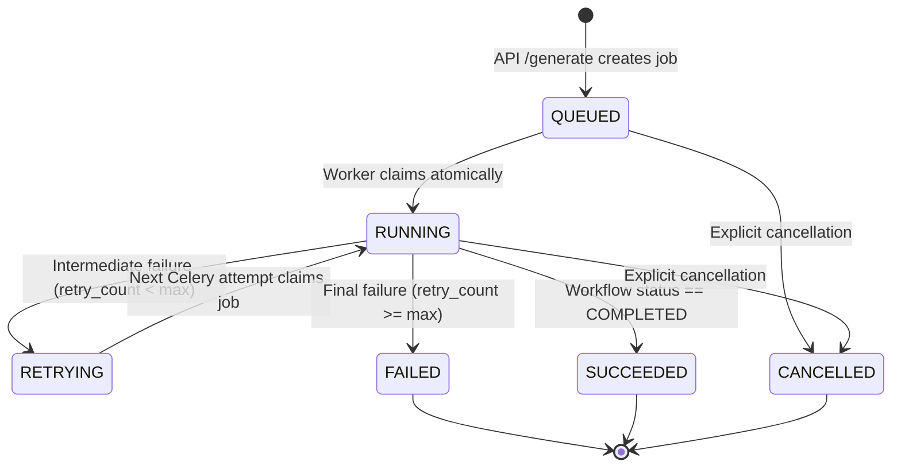

# PHASE 4.1.1 REPORT — Background Execution Reliability Fixes

> **Status:** ✅ COMPLETE
> **Date:** 2026-11-23

---

## 1. Executive Summary

Phase 4.1.1 resolved critical background execution reliability issues identified during code review of Phase 4.1:
1. **Celery Retry Lifecycle:** Corrected state transitions so retryable failures transition to `RETRYING` (not `FAILED`), increment `retry_count`, and allow subsequent deliveries to execute until retries are exhausted.
2. **Worker-Owned PostgreSQL Checkpointer:** Restored persistent `AsyncPostgresSaver` in generation workers using a dedicated connection pool (`AsyncConnectionPool`) with verified lifecycle and cleanup.
3. **Cross-Process Agent Events:** Worker processes now initialize `event_hub` on startup, routing all agent events (`Planner`, `Writer`, `Critic`, etc.) to Redis Pub/Sub so clients receive real-time updates across separate processes.
4. **Concurrency-Safe Job Claiming and Dispatch:** Added an atomic conditional update (`WHERE status IN ('QUEUED', 'RETRYING')`) to prevent duplicate executions from duplicate Celery deliveries, plus a partial unique index in migration 009 (`uq_active_generation_job`) preventing duplicate active generation jobs per episode.
5. **Real LangGraph Progress Tracking & Sanitized Errors:** Transitioned from arbitrary hardcoded progress numbers to event-driven updates driven by LangGraph node execution (`astream(..., stream_mode="updates")`). Sanitized all persisted and published error messages to redact API keys and secrets.
6. **Production Redis Guarantees:** Redis unavailability in production environment raises explicit `RuntimeError` rather than silently downgrading to in-memory delivery.

---

## 2. Root Causes and Resolutions

| Component | Root Cause in Phase 4.1 | Phase 4.1.1 Fix |
|---|---|---|
| **Celery Retry Lifecycle** | Failed jobs were marked `FAILED` on attempt 0; subsequent Celery retries saw a terminal status and skipped execution. | Failed attempts update status to `RETRYING` with attempt count and sanitized error; only exhausted retries (≥ max_retries) mark `FAILED`. |
| **Worker Checkpointer** | Worker defaulted to `MemorySaver`, preventing persistent resumption across separate worker tasks. | Worker initializes its own `AsyncPostgresSaver` backed by an `AsyncConnectionPool`, reusing existing tables and closing the pool upon task completion. |
| **Cross-Process Events** | Workers did not call `event_hub.initialize()`; agent-level `event_hub.publish()` stayed in worker-local memory. | Worker initializes `event_hub` upon task startup, ensuring all agent events broadcast to `episode:{id}` on Redis Pub/Sub. |
| **Duplicate Delivery Claiming** | Two workers receiving duplicate task deliveries could execute simultaneously if checked with non-atomic reads. | Worker executes atomic conditional update: `UPDATE background_jobs SET status='RUNNING' WHERE id=:id AND status IN ('QUEUED', 'RETRYING') RETURNING id`. |
| **Concurrent Active Jobs** | Concurrent API calls could create multiple active jobs for the same episode under race conditions. | Added partial unique index `uq_active_generation_job` in migration 009 (`WHERE status IN ('QUEUED', 'RUNNING', 'RETRYING')`) and handled `IntegrityError` by returning the winning job. |
| **Outbox Redispatch** | Startup redispatch re-sent jobs that RabbitMQ had already accepted because `dispatch_pending` was not cleared upon dispatch confirmation. | `update_celery_task_id` clears `dispatch_pending = 0` immediately upon Celery dispatch; startup redispatch only queries unassigned jobs (`celery_task_id IS NULL`). |
| **Error Leakage** | Raw exception strings containing file paths or API keys could leak into database records and SSE streams. | Created `app.core.sanitizer.sanitize_error_message` to strip tokens, API keys, credentials, and tracebacks. |
| **Production Redis Fallback** | EventHub silently defaulted to in-memory queues when Redis failed, hiding broker disconnections in production. | In `production`, Redis connection failures raise `RuntimeError` immediately. Exposed Redis connectivity status in `/health`. |

---

## 3. Files Created and Modified

| File | Change Type | Summary of Changes |
|---|---|---|
| `backend/app/core/sanitizer.py` | **New** | Redacts API keys (`AIza...`, `gsk_...`), tokens, and internal file paths from exception messages. |
| `backend/alembic/versions/009_active_job_unique_index.py` | **New** | Migration: partial unique index `uq_active_generation_job` on `(episode_id, job_type)` for active statuses. |
| `backend/app/models/job.py` | **Modified** | Added partial unique index to `__table_args__`. |
| `backend/app/core/events.py` | **Modified** | Strict production Redis initialization; added `close()` and `is_healthy` property. |
| `backend/app/services/job_service.py` | **Modified** | Concurrency-safe job creation (`IntegrityError` recovery); outbox dispatch sets `dispatch_pending = 0`; sanitized error responses. |
| `backend/app/workers/generation_tasks.py` | **Modified** | Atomic claiming via `update().returning()`; `get_worker_checkpointer()` context manager; proper `RETRYING` vs `FAILED` lifecycle; LangGraph `astream` progress updates; `event_hub` initialization. |
| `backend/app/main.py` | **Modified** | Health endpoint reports Redis connectivity status. |
| `backend/tests/test_jobs.py` | **Modified** | Added 7 new regression tests covering concurrency, retry lifecycle, error sanitization, Redis production check, and worker checkpointer. |

---

## 4. Job State Transitions



---

## 5. Test Results

### 1. Dedicated Background Job Tests (`backend/tests/test_jobs.py`)
```
26 passed, 14 warnings in 2.91s
```

Covering:
- `test_active_statuses`, `test_terminal_statuses`, `test_queued_job_is_not_terminal`, `test_failed_job_not_active`
- `test_build_job_response_no_secrets`, `test_build_job_response_fields_complete`, `test_response_times_are_iso_strings_or_none`
- `test_get_or_create_job_creates_new`, `test_get_or_create_job_reuses_active`, `test_get_or_create_job_new_after_terminal`
- `test_update_celery_task_id`, `test_dispatch_calls_apply_async`, `test_dispatch_raises_on_broker_failure`
- `test_redispatch_skips_when_broker_unavailable`
- `test_run_generation_returns_not_found_for_missing_job`, `test_run_generation_skips_terminal_job`
- `test_event_hub_in_memory_subscribe_and_publish`, `test_event_hub_terminal_event_closes_stream`
- `test_get_or_create_job_rejects_wrong_user`
- `test_concurrent_active_jobs_prevented_by_unique_constraint`
- `test_sanitized_error_reporting`
- `test_atomic_claiming_skips_already_running_job`
- `test_retry_lifecycle_transitions_to_retrying`
- `test_retry_lifecycle_transitions_to_failed_when_exhausted`
- `test_event_hub_production_raises_on_redis_failure`
- `test_worker_checkpointer_lifecycle`

### 2. Full Backend Test Suite (`backend/tests/`)
```
114 passed, 14 warnings in 17.45s
```
**100% pass rate** across all 114 backend tests.

### 3. Frontend Build (`frontend/`)
```
✓ 1588 modules transformed — built in 1.45s
0 TypeScript errors
```

---

## 6. Migration Status

- Revision `009_active_job_unique_index` applied successfully to PostgreSQL 16:
```
INFO  [alembic.runtime.migration] Running upgrade 008_background_jobs -> 009_active_job_unique_index, Add partial unique index on active background jobs
```

---

## 7. Remaining Limitations

1. **Audio Worker Queue:** `audio_tasks.py` remains a clean stub scheduled for implementation in Phase 4.2.
2. **Horizontal Worker Autoscaling:** Manual concurrency limits configured via Docker Compose (`--concurrency=2`); autoscaling policies are deferred to Phase 5.
