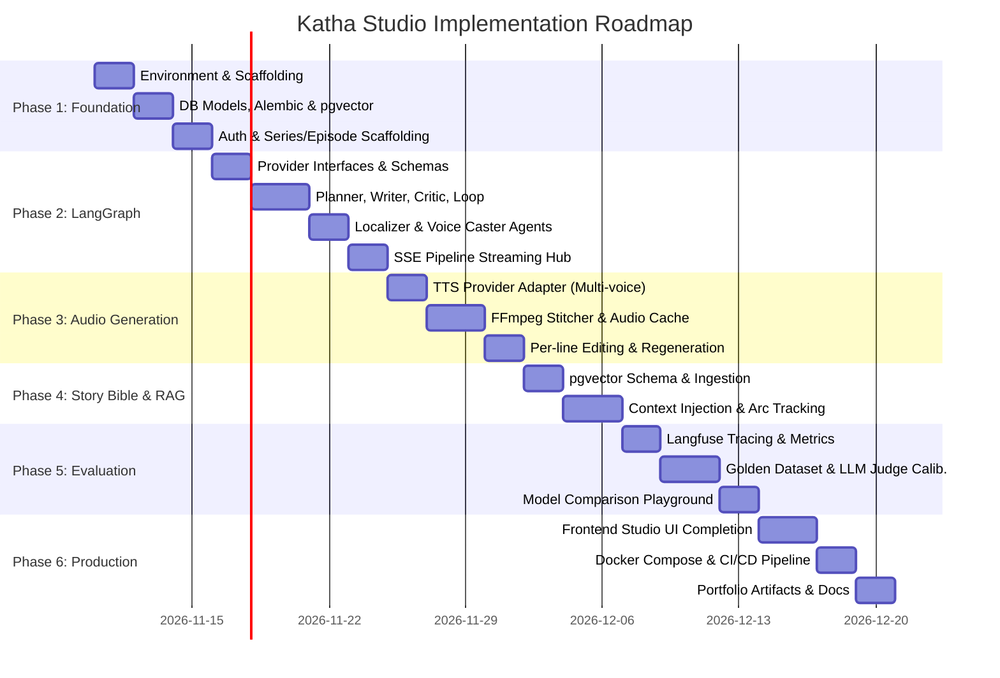

# PROJECT_CONTEXT.md — Katha Studio (कथा स्टूडियो)

> **Agentic Multilingual Audio-Story Generation Platform**  
> *Transforming premise into episodic, multi-character, immersive audio dramas across Hindi, Hinglish, and English.*

---

## 1. Executive Summary & Vision

**Katha Studio** is a production-grade, agentic AI platform designed to automate the end-to-end production of multi-character episodic audio dramas. Starting from a concise premise or logline, Katha Studio coordinates a multi-agent creative writing room (implemented via **LangGraph**) to plan narrative arcs, write multi-character scripts, critique and conditionally revise them, localize dialogue into natural Hindi, Hinglish, or English, cast distinct character voices, synthesize synchronized audio lines via TTS, and assemble finished audio episodes using FFmpeg.

Built as an exemplary **AI Systems Engineering portfolio project**, Katha Studio demonstrates:
1. **Multi-Agent Orchestration with Controlled Iteration**: Cyclic directed graphs with strict termination guarantees (maximum 2 revision cycles).
2. **Schema-Enforced Reliability**: 100% structured outputs via Pydantic; zero fragile regex or loose dict indexing.
3. **Long-Horizon Narrative Continuity**: An episodic **Story Bible** backed by PostgreSQL + `pgvector` preventing character drift, continuity errors, and voice inconsistencies across episodes.
4. **Interactive Human-in-the-Loop Audio Editing**: Per-line script editing and deterministic hash-based audio cache invalidation/regeneration.
5. **Real-time Observability & Streaming**: Live pipeline progress and node transitions streamed via Server-Sent Events (SSE).
6. **Empirical Evaluation & Model Benchmarking**: Golden datasets, calibrated LLM-as-a-judge rubrics, and automated cost/latency/quality trade-off tracking.

---

## 2. System Architecture

```mermaid
flowchart TD
    subgraph Client Layer [Frontend - React / Vite / Tailwind]
        UI[Katha Studio Web App]
        AudioPlayer[Multi-Track Waveform & Line Editor]
        SSEClient[SSE Live Progress Listener]
        EvalDash[Evaluation & Observability Dashboard]
    end

    subgraph API & Realtime Layer [FastAPI Application]
        Router[FastAPI Async Endpoints]
        Auth[JWT / Session Authentication]
        SSEManager[SSE Event Stream Hub]
        JobQueue[Async Pipeline Runner / Worker]
    end

    subgraph Agentic Orchestration Layer [LangGraph]
        Planner[1. Planner Agent]
        Writer[2. Writer Agent]
        Critic[3. Critic Agent]
        ReviseDecision{Revision Needed?<br/>Max 2 Retries}
        Localizer[4. Localizer Agent<br/>Hindi / Hinglish / English]
        VoiceCaster[5. Voice Caster Agent]

        Planner --> Writer --> Critic --> ReviseDecision
        ReviseDecision -- Yes & Retries < 2 --> Writer
        ReviseDecision -- No or Retries >= 2 --> Localizer
        Localizer --> VoiceCaster
    end

    subgraph Audio & Media Layer
        TTSEngine[TTS Provider Interface<br/>Sarvam / ElevenLabs / Azure]
        AudioCache[Deterministic Audio Segment Cache]
        FFmpegAssembler[FFmpeg Audio Stitcher & Normalizer]
    end

    subgraph Persistence & Memory Layer [PostgreSQL + Redis]
        RelationalDB[(PostgreSQL 16<br/>Users, Series, Episodes, Scripts)]
        VectorDB[(pgvector<br/>Story Bible: Characters, Lore, Milestones)]
        RedisCache[(Redis<br/>SSE Pub/Sub, Ephemeral State, Rate Limits)]
    end

    subgraph Observability & Evaluation
        LangfuseClient[Langfuse / OTel Tracing]
        EvalHarness[Golden Dataset & LLM Judge]
    end

    %% Connections
    UI <--> Router
    SSEClient <--> SSEManager
    Router --> JobQueue
    JobQueue --> Agentic Orchestration Layer
    
    Planner -. Query Story Bible .-> VectorDB
    Writer -. Retrieve Lore .-> VectorDB
    VoiceCaster -. Store New Entities .-> VectorDB

    VoiceCaster --> TTSEngine
    TTSEngine --> AudioCache
    AudioCache --> FFmpegAssembler
    FFmpegAssembler --> RelationalDB

    Agentic Orchestration Layer -. Emit Events .-> RedisCache
    RedisCache -. Pub/Sub .-> SSEManager
    Agentic Orchestration Layer -. Traces .-> LangfuseClient
    EvalHarness -. Benchmark Runs .-> LangfuseClient
```

---

## 3. Core Functional Components

### 3.1 LangGraph Orchestration Pipeline
The storytelling pipeline is modeled as an explicit state graph with typed state and deterministic transitions:

1. **Planner Agent**:
   - Ingests user premise, target duration, language, genre, and series history.
   - Queries the **Story Bible** (`pgvector`) for recurring characters, unresolved narrative threads, and world rules.
   - Outputs a validated `EpisodeOutline` schema: beat sheet, emotional progression, character appearances, scene breakdown.
2. **Writer Agent**:
   - Expands beats into a full multi-character script with dialogue lines, scene stage directions, and emotional markers.
   - Outputs an initial `RawScript` schema containing structured dialogue lines tagged by character, emotion, pace, and subtext.
3. **Critic Agent**:
   - Evaluates the script against predefined, weighted dramatic criteria:
     - Narrative pacing & coherence.
     - Character voice distinctiveness & consistency with Story Bible.
     - Dialogue naturalness and show-don't-tell execution.
     - Formatting & structural integrity.
   - Outputs a structured `CritiqueReport` with numerical scores (1–10) and specific, actionable feedback per line/beat.
4. **Conditional Revision Edge**:
   - If `score < threshold` and `revision_count < 2`, branches back to **Writer Agent** with critique feedback attached to state.
   - If criteria are met or `revision_count == 2`, proceeds to localization.
5. **Localizer Agent**:
   - Adapts dialogue to the target linguistic style:
     - **Hindi**: Natural conversational Hindi with culturally authentic idioms and appropriate honorifics (आप/तुम/तू).
     - **Hinglish**: Natural urban code-switching (Romanized or Devanagari script based on target TTS capability).
     - **English**: Idiomatic English with genre-appropriate cadence.
   - Outputs a localized `LocalizedScript` maintaining exact character attribution and timing cues.
6. **Voice Caster Agent**:
   - Matches each character to a suitable voice identifier from the active TTS voice catalog based on gender, age, tone, and vocal texture.
   - Ensures narrator vs. character contrast and audio frequency balance.
   - Outputs a `CastScript` ready for audio synthesis.

### 3.2 Audio Synthesis & FFmpeg Engine
- **Deterministic Audio Caching**: Every audio line is keyed by `SHA256(text + voice_id + speed + pitch + provider_model)`. Unchanged lines are never re-synthesized, slashing latency and API cost.
- **Per-Line Regeneration**: Users can tweak a single dialogue line, re-synthesize that exact audio snippet, and re-stitch the episode without re-running the entire LangGraph pipeline.
- **Audio Timeline Assembly**:
  - Normalization (EBU R128 loudness standards).
  - Micro-pauses and inter-dialogue pacing (e.g. 200–500ms conversational pause, longer scene transitions).
  - Clean concatenation or multi-track mix (speech + ambient bed / sound effects).

### 3.3 Persistent Story Bible (PostgreSQL + pgvector)
To avoid episodic drift across a series:
- **Entities**: Characters (traits, backstories, quirks, vocal profiles), Locations, Factions/Organizations, Magic/Tech systems, Historical events.
- **Episodic Summaries**: Vector embeddings of previous episode beats, cliffhangers, and unresolved character arcs.
- **RAG Retrieval**: Before planning Episode $N$, the Planner retrieves top-$K$ relevant lore vectors to maintain narrative consistency and lore fidelity.

### 3.4 Live Progress Streaming (SSE)
- LangGraph node executions dispatch structured lifecycle events (`node_start`, `node_progress`, `revision_cycle`, `tts_progress`, `pipeline_complete`) to Redis Pub/Sub.
- FastAPI SSE endpoint subscribes to the episode's channel and streams events in real-time to the React frontend.

### 3.5 Evaluation, Calibration & Observability
- **Langfuse Integration**: Full trace hierarchy from graph invocation down to individual tool calls, token usage, latency, and cost per episode.
- **LLM-as-a-Judge**: Custom evaluation harness grading episodes on Dialogue Quality, Story Structure, Continuity Fidelity, and Localization Naturalness.
- **Calibration Benchmark**: Human-annotated golden set vs. LLM judge scores to measure Spearman correlation and eliminate judge bias.
- **Model Comparison Arena**: Capability to run identical premises across Gemini 1.5/2.0, Groq (Llama 3.3), and Claude models to benchmark cost vs. quality.

---

## 4. Technical Stack

| Category | Technology | Rationale |
|---|---|---|
| **Backend Framework** | **FastAPI** (Python 3.11+) | Async high-performance REST + SSE streaming; native Pydantic v2 support. |
| **Database & Vectors** | **PostgreSQL 16 + pgvector** | Unified relational and vector store; simplifies infrastructure and joins. |
| **ORM & Migrations** | **SQLAlchemy 2.0 (asyncio) + Alembic** | Robust typed async ORM with explicit migration history. |
| **Cache & Pub/Sub** | **Redis 7** | Sub-millisecond pub/sub for SSE streaming, distributed locking, and rate limiting. |
| **Agent Framework** | **LangGraph** (LangChain Core) | Deterministic state machine with native support for cycles, checkpoints, and human-in-the-loop. |
| **Audio Processing** | **FFmpeg + PyAV / pydub** | Industry standard for audio concatenation, loudness normalization, and format conversion. |
| **Frontend Framework** | **React 18 + Vite + TypeScript** | Responsive modern UI with static typing and rapid compilation. |
| **Styling & Components**| **Tailwind CSS + Lucide Icons + Radix UI** | Clean, accessible design system for complex studio tooling. |
| **Audio Visualization**| **Wavesurfer.js** | Interactive audio waveform rendering, seek, and per-line playback markers. |
| **Observability** | **Langfuse** (self-hosted or cloud) | Dedicated LLM observability tracking graph traces, cost, latency, and evaluations. |
| **DevOps & Containers**| **Docker, Docker Compose, GitHub Actions** | Reproducible multi-service deployment and automated CI test pipeline. |

---

## 5. Phased Implementation Roadmap



### Detailed Phase Milestones:
- **Phase 1: Foundation and Authentication**
  - Project directory structure, Poetry/Pipenv/uv package management, Docker Compose for Postgres + pgvector + Redis.
  - Async SQLAlchemy setup, Alembic migrations, database models for `User`, `Series`, `Episode`, `Script`, `AudioTrack`.
  - JWT-based authentication, user series/episode CRUD endpoints, and test coverage.
- **Phase 2: LangGraph Agentic Pipeline**
  - Abstract LLM provider interface (`BaseLLMClient`) supporting Gemini and Groq.
  - Strict Pydantic schemas for each node state.
  - LangGraph implementation: Planner, Writer, Critic, Conditional Revision Edge (max 2 iterations), Localizer, and Voice Caster.
  - Real-time SSE streaming from LangGraph callbacks to Redis Pub/Sub.
- **Phase 3: Audio Generation Engine**
  - Abstract `BaseTTSClient` interface supporting multi-language synthesis.
  - Audio asset management with SHA-256 hash-based caching.
  - FFmpeg stitcher: silence padding, cross-fades, volume normalization.
  - Interactive per-line regeneration endpoint and frontend waveform synchronization.
- **Phase 4: Story Bible and RAG Memory**
  - Story Bible schema: character profiles, voice characteristics, relationships, locations, narrative lore.
  - Multilingual vector embeddings stored in `pgvector`.
  - Context retrieval integrated into Planner and Writer nodes for continuity enforcement.
- **Phase 5: Evaluation, Observability & Experiments**
  - Langfuse integration for trace visualization, token counting, and latency metrics.
  - Golden evaluation dataset across genres and languages.
  - Calibrated LLM-as-a-judge system with pairwise comparison and rating rubrics.
  - Automated benchmark script comparing Gemini vs. Groq vs. Claude models.
- **Phase 6: Deployment, Frontend Polish & Documentation**
  - Production-ready React studio frontend with interactive line-by-line script editor and multi-character audio player.
  - Production Docker Compose configuration.
  - GitHub Actions CI for linting (ruff, black, mypy), backend tests (pytest), and frontend tests (vitest).
  - Architectural documentation, API specs, and portfolio presentation.

