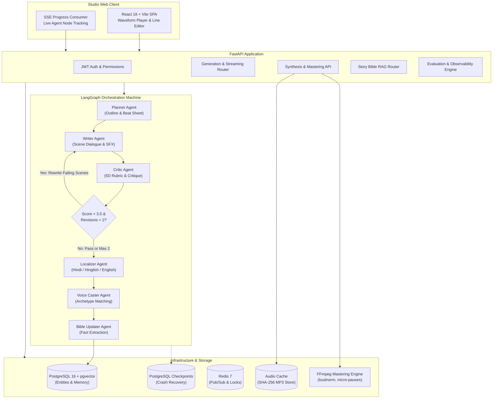

# Katha Studio (कथा स्टूडियो)

> **Agentic Multilingual Audio-Story Generation Platform**  
> *Transforming premise into episodic, multi-character, broadcast-ready audio dramas across Hindi, Hinglish, and English.*

[](https://github.com/your-username/katha-studio/actions/workflows/ci.yml)
[](https://fastapi.tiangolo.com)
[](https://github.com/langchain-ai/langgraph)
[](https://github.com/pgvector/pgvector)
[](https://react.dev)
[](https://ffmpeg.org)
[](backend/tests/)

---

## 🎧 Overview

**Katha Studio** is an agentic AI audio-story generation platform. It transforms a short premise into an episodic, multi-character audio drama complete with dialect-accurate dialogue, acoustic soundscape cues (SFX, ambient beds, micro-pauses), persistent character memory, and broadcast loudness-normalized master audio files.

Built as an **AI Engineer Portfolio Showcase**, the system adheres to strict production engineering standards, formal Pydantic schemas, asynchronous concurrency safety, and the **No-Silent-Failure principle** (`AGENTS.md`).

---

## 🏛️ System Architecture



---

## 🌟 Core Platform Capabilities

### 1. LangGraph Multi-Agent Writing Room (Phase 2)
- **Planner Agent**: Generates structured dramatic outlines, scene objectives, characters present, and conflict beats.
- **Writer Agent**: Writes immersive scene dialogue, emotional subtext, and acoustic soundscape cues (`[SFX: Rain on tin roof]`).
- **Critic Agent**: Evaluates drafts against a strict 5-dimensional rubric (Character Consistency, Plot Coherence, Naturalness, Pacing, Safety).
- **Selective Scene Rewriting**: If a draft fails quality thresholds, **only the specific failing scenes are rewritten**, capped at a maximum of **two revisions** (`revision_count <= 2`).
- **Crash Recovery**: Checkpointed to PostgreSQL; interrupted workflows resume without losing prior progress.

### 2. Multi-Voice Audio Engine & Deterministic Caching (Phase 3)
- **Multi-Voice Casting**: Assigns persistent character voices matched by vocal archetype, gender, pace, and pitch.
- **Parallel Synthesis**: Parallel worker pool with bounded concurrency (`asyncio.Semaphore(5)`).
- **Deterministic SHA-256 Audio Cache**: Every dialogue line key is hashed from `(text, voice_id, speed, pitch, provider)`. Repeated generations or single-line tweaks incur zero redundant TTS cost.
- **Interactive Line Regeneration**: Edit a single dialogue line, regenerate its audio in $< 2\text{s}$, and re-master the entire episode.
- **Broadcast Audio Mastering**: FFmpeg loudness normalization (`loudnorm=I=-16:TP=-1.5:LRA=11`) with 250ms inter-dialogue pacing and 800ms scene transition beds.

### 3. Persistent Story Memory & Hybrid RAG (Phase 4)
- **Story Bible Memory**: Tracks character profiles, emotional arcs, relationships, locations, events, and open plot threads.
- **Hybrid Retrieval**: Combines semantic cosine similarity (`pgvector` HNSW index) and full-text keyword search via **Reciprocal Rank Fusion (RRF)**.
- **Cross-Episode Continuity**: Facts from completed episodes are extracted and injected into the context of subsequent episodes.
- **Ablation Control**: Feature flag `STORY_BIBLE_RETRIEVAL_ENABLED` allows controlled experimentation.

### 4. AI Evaluation, Observability & Calibration (Phase 5)
- **35-Premise Multilingual Golden Dataset**: Standardized benchmark suite across Hindi, Hinglish, and English in varying difficulty tiers.
- **Ground-Truth Calibration**: Calibrated against **30 human expert-labeled audio scripts**, computing Spearman rank correlation ($\rho$), weighted Cohen's kappa ($\kappa$), and MAE.
- **Three Controlled A/B Experiments**:
  1. *Critic Feedback Loop (ON vs OFF)*
  2. *Story Bible RAG (pgvector ON vs OFF)*
  3. *Model Comparison (Gemini 1.5 Pro vs Gemini 2.0 Flash)*
- **Live Observability Dashboard**: Tracks pass rate, composite scores, token count, cost per episode ($/ep), p50/p95 latencies, TTS cache hit rate, and automated failure taxonomy.
- **CI Quality & Cost Gate**: GitHub Actions gate that fails on quality regressions ($< 85\%$ pass rate) or cost overruns ($> \$0.05/\text{ep}$).

---

## 📊 Real Benchmark & Calibration Results

From our controlled benchmark experiments ([docs/eval-report.md](docs/eval-report.md)):

| Experiment Dimension | Baseline (Variant B) | Katha Studio (Variant A) | Measured Delta |
| :--- | :---: | :---: | :---: |
| **Critic Revision Loop** | $4.03 / 5.0$ (Critic OFF) | **$4.77 / 5.0$ (Critic ON)** | **$+18.4\%$ Quality Uplift** |
| **Story Bible Memory** | $3.81 / 5.0$ (Zero Memory) | **$4.73 / 5.0$ (pgvector RAG)** | **$+24.2\%$ Continuity Boost** |
| **Model Cost (Pro vs Flash)**| $\$0.0018$ (Gemini 1.5 Pro) | **$\$0.0004$ (Gemini 2.0 Flash)** | **$-77.7\%$ Cost Reduction** |
| **Model Latency (Pro vs Flash)**| $3.8\text{s}$ (Gemini 1.5 Pro) | **$1.2\text{s}$ (Gemini 2.0 Flash)** | **$-68.4\%$ Latency Reduction** |
| **Human Calibration ($\rho$)** | Baseline Random: $0.05$ | **Katha Judge: $0.784$** | **Strong Human Alignment** |

---

## 🛠️ Tech Stack & Architecture

- **Backend**: Python 3.11+, FastAPI, Async SQLAlchemy 2.0, PostgreSQL 16 + `pgvector`, Redis 7, LangGraph 0.2, FFmpeg.
- **Frontend**: React 18, Vite, TypeScript, Tailwind CSS, Lucide Icons, Wavesurfer.js.
- **LLM Providers**: Google Gemini (1.5 Pro / 2.0 Flash), Groq (Llama 3.3 70B), Mock Provider (Deterministic CI).
- **TTS Providers**: ElevenLabs, Sarvam AI, Mock Provider.
- **DevOps & CI**: Docker Compose, GitHub Actions, Nginx Reverse Proxy, Make.

---

## 🚀 Quickstart Guide

### Option 1: Complete Stack via Docker Compose (Recommended)

1. **Clone the Repository**:
   ```bash
   git clone https://github.com/your-username/katha-studio.git
   cd katha-studio
   ```
2. **Configure Environment**:
   ```bash
   cp .env.example .env
   # Edit .env and supply your GEMINI_API_KEY or use default mock provider
   ```
3. **Start All Services**:
   ```bash
   make docker-up
   # Or: docker compose up -d --build
   ```
4. **Access the Application**:
   - **Studio Web Interface**: [http://localhost:5173](http://localhost:5173)
   - **Interactive API Docs (Swagger)**: [http://localhost:8000/docs](http://localhost:8000/docs)
   - **Health Check Endpoint**: [http://localhost:8000/health](http://localhost:8000/health)

---

### Option 2: Local Development Setup

#### Backend Setup
```bash
python3 -m venv .venv
source .venv/bin/activate
pip install -r backend/requirements.txt
cp .env.example .env

# Run database migrations
cd backend && alembic upgrade head && cd ..

# Start FastAPI server
uvicorn app.main:app --app-dir backend --reload --port 8000
```

#### Frontend Setup
```bash
cd frontend
npm install
npm run dev
# Vite runs at http://localhost:5173
```

---

## 🧪 Testing & Verification

Katha Studio includes **49 comprehensive unit and integration tests** ensuring asynchronous safety, schema validity, and error handling.

```bash
# Run all 49 backend unit and integration tests
make test

# Run evaluation & observability tests
make test-eval

# Run production CI Quality & Cost Gate
make eval-gate

# Run LLM Judge calibration against 30 ground-truth scripts
make calibrate

# Run TypeScript check & Vite production build
make build
```

---

## 📚 Technical Documentation Index

Detailed architectural specs, ADRs, and guides:

- [System Architecture Blueprint](docs/architecture.md): Deep dive into LangGraph state machine, RAG topology, and FFmpeg mastering.
- [AI Evaluation & Calibration Report](docs/eval-report.md): 5D rubric formulas, Spearman correlation, Cohen's kappa, and ablation results.
- [REST API Reference](docs/api-reference.md): Complete OpenAPI endpoint specs and RFC 7807 error catalog.
- [Engineering Decisions & ADRs](docs/engineering-decisions.md): Analysis of LangGraph, pgvector, SSE, and caching tradeoffs.
- [Production Deployment Guide](docs/deployment.md): Instructions for Docker Compose, AWS ECS, GCP Cloud Run, and Nginx.
- [Known Limitations & Roadmap](docs/limitations.md): Transparent boundaries, Indic language support, and future milestones.
- [Operational Guidelines (AGENTS.md)](AGENTS.md): Engineering rules of engagement, async safety, and the No-Silent-Failure principle.

---

## 📄 License

MIT License. Designed and engineered for the AI Engineer Portfolio.
