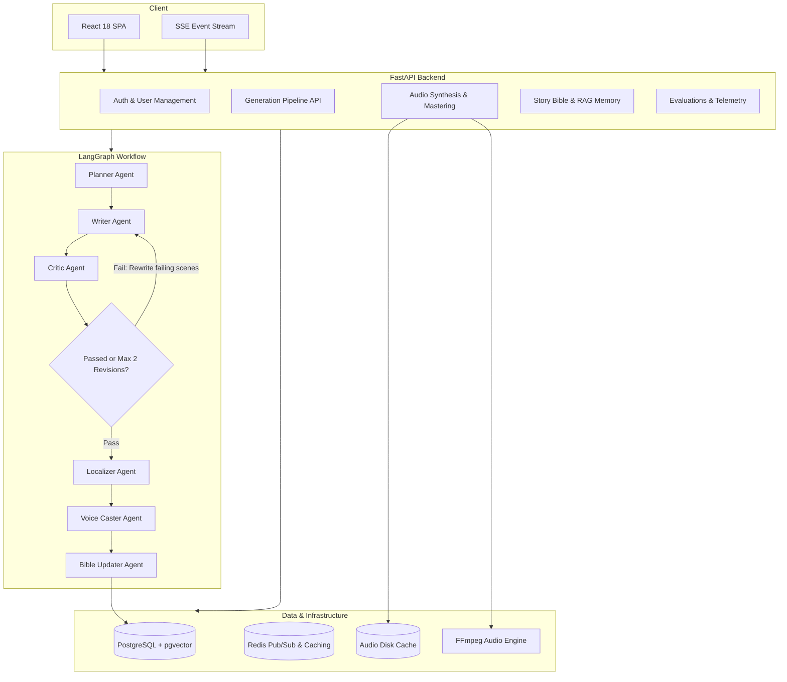

# Katha Studio

Katha Studio is an agentic platform for generating multilingual audio stories and dramas in Hindi, Hinglish, and English. Given a premise, the system orchestrates an iterative multi-agent writing room using LangGraph, synthesizes multi-character dialogue using TTS providers, and stitches mastered audio tracks with dynamic micro-pauses and loudness normalization via FFmpeg.

---

## Architecture

The system is designed around an asynchronous pipeline decoupling agent orchestration, audio rendering, and client streaming:



---

## Features

### Multi-Agent Story Generation
- **Structured Script Outlines**: Generates beat-by-beat dramatic scenes, acoustic soundscape directions (ambient beds, sound effects), and character archetypes.
- **Bounded Revision Loop**: A Critic agent evaluates consistency, plot coherence, pacing, and dialogue naturalness. If quality checks fail, only the specific failing scenes are rewritten, strictly capped at two iterations.
- **State Checkpointing**: LangGraph state is backed by PostgreSQL checkpoints, allowing recovery and pause/resume of long-running workflows.
- **Real-Time Progress Streaming**: Emits live node-level progress events to the client over Server-Sent Events (SSE).

### Multi-Voice Audio Mastering
- **Voice Casting**: Automatically maps characters to distinct voices based on gender, vocal archetype, pace, and pitch.
- **Deterministic Audio Cache**: Dialogue lines are cached by a hash of `(normalized_text, voice_id, speed, pitch, provider)`. Unmodified lines load instantly from disk.
- **Interactive Line Regeneration**: Edit individual lines in the studio UI and re-synthesize only that segment without regenerating the entire episode.
- **Broadcast Loudness Normalization**: Uses FFmpeg filter chains for dialogue pacing (250ms inter-speaker pauses, 800ms scene transitions) and EBU R128 / ITU-R BS.1770-4 loudness normalization (`-16 LUFS`).

### Persistent Story Memory (RAG)
- **Story Bible**: Stores characters, relationships, locations, events, and open plot threads in PostgreSQL.
- **Hybrid Retrieval**: Combines dense vector similarity (`pgvector` cosine distance) and sparse keyword search using Reciprocal Rank Fusion (RRF) to preserve continuity across multi-episode arcs.
- **Ablation Support**: Toggleable via `STORY_BIBLE_RETRIEVAL_ENABLED` for comparative benchmarking.

### Evaluation and Observability
- **Standardized Golden Dataset**: Includes 35 curated premises across Hindi, Hinglish, and English across multiple difficulty tiers.
- **Pydantic LLM Judge**: Grades scripts on a 1–5 scale across Character Consistency, Plot Coherence, Language Naturalness, Pacing, and Safety.
- **Human Calibration**: Evaluated against 30 expert-labeled scripts calculating Spearman rank correlation ($\rho$), weighted Cohen's kappa ($\kappa$), and MAE.
- **Telemetry & Cost Tracking**: Captures latency percentiles (p50/p95), token counts, estimated dollar costs, and synthesis cache hit rates.
- **Automated Quality Gate**: CI pipeline fails builds if quality drops below 85% pass rate or per-episode generation costs exceed configured thresholds.

---

## Tech Stack

| Layer | Technologies |
| :--- | :--- |
| **Backend** | Python 3.11+, FastAPI, SQLAlchemy 2.0 (async), Alembic, Pydantic v2 |
| **Orchestration** | LangGraph 0.2+, LangChain Core |
| **Database & Cache** | PostgreSQL 16 with `pgvector`, Redis 7 |
| **Audio Processing** | FFmpeg, Python-subprocess worker pools |
| **Frontend** | React 18, Vite, TypeScript, Tailwind CSS, Wavesurfer.js, Lucide Icons |
| **Providers** | Google Gemini (1.5 Pro / 2.0 Flash), Groq, ElevenLabs, Sarvam AI, Mock provider |
| **DevOps** | Docker Compose, Nginx, GitHub Actions |

---

## Getting Started

### Prerequisites
- Docker and Docker Compose (recommended), or Python 3.11+ and Node.js 20+
- FFmpeg installed locally (if running outside Docker)

### Option 1: Docker Compose

1. Clone the repository:
   ```bash
   git clone https://github.com/aaditya156/Katha.git
   cd Katha
   ```

2. Copy the environment configuration:
   ```bash
   cp .env.example .env
   ```

3. Start all services:
   ```bash
   docker compose up -d --build
   ```

4. Open the application:
   - Frontend Studio: [http://localhost:5173](http://localhost:5173)
   - API Docs (Swagger): [http://localhost:8000/docs](http://localhost:8000/docs)
   - Health Check: [http://localhost:8000/health](http://localhost:8000/health)

---

### Option 2: Local Development

#### Backend Setup
```bash
python3 -m venv .venv
source .venv/bin/activate
pip install -r backend/requirements.txt
cp .env.example .env

# Run database migrations
cd backend
alembic upgrade head
cd ..

# Start FastAPI server
uvicorn app.main:app --app-dir backend --reload --port 8000
```

#### Frontend Setup
```bash
cd frontend
npm install
npm run dev
```

The frontend will run at `http://localhost:5173` and proxy API requests to `http://127.0.0.1:8000`.

---

## Testing

The project has a comprehensive test suite covering authentication, database transactions, LangGraph execution, RAG retrieval, audio assembly, and evaluation metrics:

```bash
# Run all backend unit and integration tests
make test

# Run evaluation and observability tests
make test-eval

# Run the CI quality and cost gate
make eval-gate

# Run TypeScript check and frontend production build
make build
```

---

## Project Structure

```
.
├── backend/
│   ├── alembic/              # Database migration scripts
│   ├── app/
│   │   ├── agents/           # LangGraph agents (planner, writer, critic, localizer, etc.)
│   │   ├── api/v1/           # API routes (auth, series, episodes, audio, evaluations)
│   │   ├── core/             # Configuration, database engine, telemetry, exceptions
│   │   ├── eval/             # Golden benchmark dataset and calibration dataset
│   │   ├── models/           # SQLAlchemy models (User, Series, Episode, StoryBible, Evaluation)
│   │   ├── providers/        # LLM and TTS provider abstraction layer
│   │   ├── schemas/          # Pydantic v2 validation models
│   │   ├── services/         # Audio stitcher, evaluator, experiment runner, RAG search
│   │   └── main.py           # FastAPI application entrypoint
│   ├── scripts/              # CI evaluation gate script
│   ├── tests/                # Pytest unit and integration test suite
│   ├── Dockerfile            # Multi-stage backend container with FFmpeg
│   └── requirements.txt      # Python dependencies
├── frontend/
│   ├── src/
│   │   ├── context/          # Authentication context
│   │   ├── pages/            # Studio pages (Series, Episodes, Evaluation Dashboard)
│   │   ├── services/         # Typed API client
│   │   ├── types/            # TypeScript interfaces aligned with backend schemas
│   │   └── App.tsx           # Application routes
│   ├── nginx.conf            # Reverse proxy configuration with SSE support
│   └── Dockerfile            # Multi-stage production container
├── docs/                     # Technical documentation
│   ├── architecture.md       # Detailed system architecture
│   ├── api-reference.md      # API endpoint documentation
│   ├── eval-report.md        # Evaluation rubric and calibration analysis
│   ├── engineering-decisions.md # Architecture Decision Records (ADRs)
│   ├── deployment.md         # Production deployment guide
│   └── limitations.md        # System limitations and roadmap
├── docker-compose.yml        # Development Docker Compose configuration
├── docker-compose.prod.yml   # Production Docker Compose configuration
├── Makefile                  # Developer CLI commands
└── README.md
```

---

## Documentation

- [System Architecture](docs/architecture.md)
- [API Reference](docs/api-reference.md)
- [Evaluation & Calibration Report](docs/eval-report.md)
- [Engineering Decisions (ADRs)](docs/engineering-decisions.md)
- [Production Deployment Guide](docs/deployment.md)
- [Limitations & Roadmap](docs/limitations.md)
- [Engineering Guidelines (AGENTS.md)](AGENTS.md)

---

## License

This project is licensed under the MIT License.
