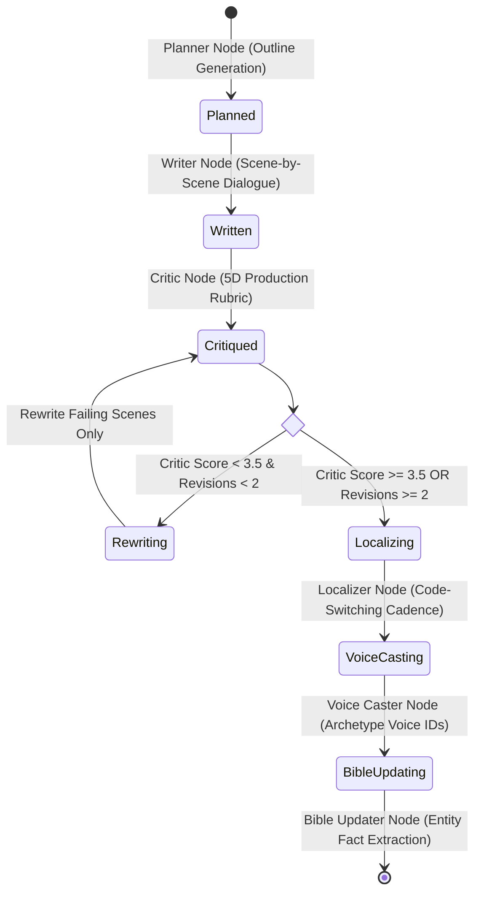
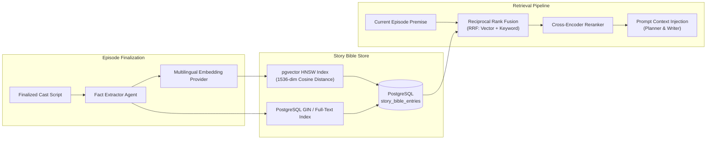
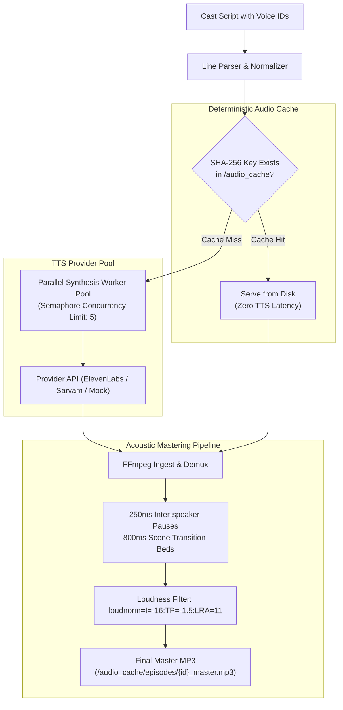

# Katha Studio: System Architecture & Engineering Blueprint

> **Production Architecture Specification for Agentic Multilingual Audio Drama Generation**  
> *FastAPI, LangGraph, PostgreSQL + pgvector, Redis, FFmpeg, and React 18*

---

## 1. High-Level System Architecture

Katha Studio is structured as an asynchronous, event-driven micro-monolith separating heavy agent orchestration and audio manipulation from low-latency client delivery.

```mermaid
flowchart TD
    subgraph Client Layer
        Web["React 18 + Vite SPA\n(Audio Waveform Player & Script Editor)"]
        SSE["SSE Progress Consumer\n(EventSource Reconnecting Bus)"]
    end

    subgraph Edge & Ingress
        Nginx["Nginx Reverse Proxy & Static Cache\n(proxy_buffering off for SSE)"]
    end

    subgraph Backend Services [FastAPI Application]
        Auth["JWT Auth & Permissions"]
        SeriesAPI["Series & Episode Management"]
        StoryAPI["Story Bible RAG Service"]
        AudioAPI["Audio Assembly & Synthesis Router"]
        EvalAPI["Evaluation & Observability Engine"]
    end

    subgraph Agentic Orchestration [LangGraph State Machine]
        Planner["Planner Agent\n(Outline & Beat Sheet)"]
        Writer["Writer Agent\n(Scene Dialogue & SFX)"]
        Critic["Critic Agent\n(Consistency & Coherence)"]
        Router{"Failing Scenes\nRevisions < 2?"}
        Localizer["Localizer Agent\n(Hindi / Hinglish / English)"]
        VoiceCaster["Voice Caster Agent\n(Archetype Matching)"]
        BibleUpdater["Bible Updater Agent\n(Fact Extraction)"]
    end

    subgraph Persistence & Audio Infrastructure
        PG["PostgreSQL 16 + pgvector\n(HNSW Cosine Vector Index)"]
        Checkpointer["PostgreSQL LangGraph Checkpointer\n(Resilience & State Recovery)"]
        Redis["Redis 7\n(Pub/Sub Streaming & Synthesis Locks)"]
        AudioCache["Deterministic Audio Disk Cache\n(SHA-256 Hashed Line MP3s)"]
        FFmpeg["FFmpeg Audio Stitcher\n(loudnorm, micro-pauses, crossfade)"]
    end

    Web -->|REST API| Nginx
    SSE -->|Live Event Stream| Nginx
    Nginx --> Backend Services

    Backend Services --> PG
    Backend Services --> Redis
    Backend Services --> Agentic Orchestration

    Planner --> Writer
    Writer --> Critic
    Critic --> Router
    Router -->|Pass or Max Revisions| Localizer
    Router -->|Rewrite Failing Scenes| Writer
    Localizer --> VoiceCaster
    VoiceCaster --> BibleUpdater
    BibleUpdater --> PG

    Agentic Orchestration -. Checkpoints .-> Checkpointer
    AudioAPI --> AudioCache
    AudioAPI --> FFmpeg
    AudioAPI --> Redis
```

---

## 2. LangGraph State Machine & Revision Loop

The core story generation pipeline is modelled as a stateful, cyclic directed graph using **LangGraph**:



### Invariant Guarantees:
1. **Bounded Loop Invariant**: Revisions are strictly capped at `revision_count <= 2`. Under no circumstances can an infinite revision cycle occur.
2. **Selective Scene Regeneration**: When a critique identifies flaws, only the specific failing scene indices (`failing_scene_numbers`) are passed back to the Writer node. Unmodified scenes are preserved, avoiding token waste.
3. **State Resiliency**: Every state transition is written to the PostgreSQL `checkpoints` table. If the process is terminated mid-generation, it can be resumed seamlessly from the last completed node.

---

## 3. Persistent Story Memory & Hybrid RAG (Phase 4)

To prevent character amnesia and lore drift across long-running audio series, Katha Studio utilizes **PostgreSQL + pgvector** for persistent memory.



### Hybrid Retrieval Mechanics:
- **Vector Search**: Captures semantic nuance, emotional states, and conceptual relationships using cosine distance.
- **Keyword Search**: Captures exact character names, artifact names, and geographical locations using PostgreSQL full-text search.
- **Reciprocal Rank Fusion (RRF)**:
  $$\text{RRF Score}(d) = \sum_{m \in \{\text{vector}, \text{keyword}\}} \frac{1}{60 + \text{rank}_m(d)}$$
- **Ablation Control**: The `STORY_BIBLE_RETRIEVAL_ENABLED` flag enables controlled A/B testing of memory impact on script continuity.

---

## 4. Multi-Voice Audio Generation & FFmpeg Assembly (Phase 3)

The audio engine transforms localized dialogue into a fully mixed, multi-character broadcast episode.



### Audio Guarantees:
- **Zero Mock Silence Substitution**: Failed synthesis raises explicit exceptions; audio files are validated for minimum byte size (> 100 bytes) and valid MP3 sync headers before passing to FFmpeg.
- **Per-Line Regeneration**: Users can tweak a single dialogue line, re-synthesize only that line's audio, and re-stitch the master track in $< 2\text{s}$.
- **Broadcast Loudness**: Enforces ITU-R BS.1770-4 / EBU R128 standard ($-16\text{ LUFS}$) for professional audiobook and podcast distribution.

